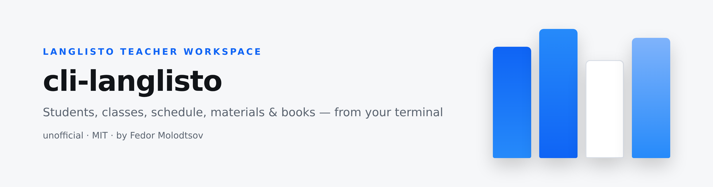
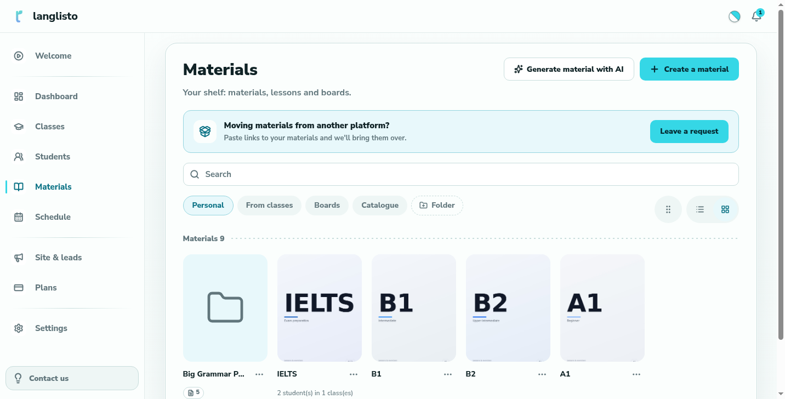
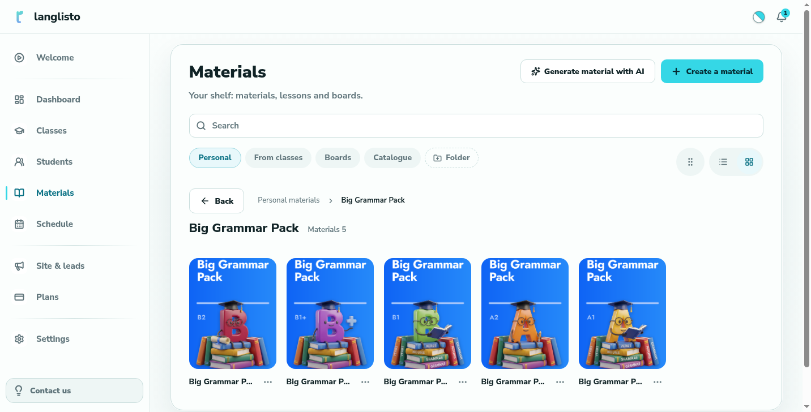

<picture>
  <source media="(prefers-color-scheme: dark)" srcset="assets/banner-dark.png">
  
</picture>

<p align="center"><sub><b>Fedor Molodtsov</b> — AI automation engineer · <a href="https://github.com/itsfedor">github.com/itsfedor</a></sub></p>

# ⌨️ cli-anything-langlisto: drive LangListo from your terminal

**An unofficial CLI for [LangListo](https://app.langlisto.com) — the ESL teaching
platform — with a bundled agent skill.**

[](https://www.python.org/)
[](LICENSE)
[](skills/cli-anything-langlisto/SKILL.md)

LangListo keeps students, classes, the schedule and all lesson materials inside
a Vite SPA with **no public API**. This project reverse-engineered the JSON API
and wraps it in a small, scriptable CLI — so you *(or your AI agent)* can set up
a whole school workspace from the command line instead of clicking through the UI.

Built out of a real, urgent need: moving a working ESL practice off Edvibe
after its outage — 12 students, 9 classes, a full weekly schedule and lesson
materials, all rebuilt on LangListo in one evening with these exact commands.

## Installation

Requires **Python 3.9+**. No Node, no server, no extras.

```bash
pipx install git+https://github.com/itsfedor/cli-anything-langlisto
```

Or clone + pip:

```bash
git clone https://github.com/itsfedor/cli-anything-langlisto
cd cli-anything-langlisto
pip install -e .
```

Check the setup:

```bash
cli-anything-langlisto doctor
```

Then log in once — the session token is cached at `~/.langlisto/session.json`
(mode 600); your password is never stored and never leaves your machine:

```bash
cli-anything-langlisto login        # asks for email + hidden password
```

Non-interactive alternative for scripts:

```bash
export LANGLISTO_EMAIL="you@example.com"
export LANGLISTO_PASSWORD="..."
```

> The CLI only works with *your* account: every request runs from your machine,
> under your login. Nothing is shared between users.

## Use cases

**1 · Import students, classes and the schedule.**

```bash
cli-anything-langlisto students add --name "Nadia"            # + --email or --domain
cli-anything-langlisto classes create --name "Nadia — English" --kind individual \
    --student nadia@example.com
cli-anything-langlisto schedule add --class "Nadia — English" --at "2026-11-03 14:00" --duration 60
cli-anything-langlisto schedule list --days 3
```

Hand each student their login in one command — `students creds <name> --link`
returns a ready sign-in link (passwords stay out of your way).

**2 · Build a full lesson material from one JSON spec.**

Describe the lesson once — sections, exercises, answers, model answers, media —
then let the CLI build it inside a course on the Materials shelf:

```bash
cli-anything-langlisto materials build lesson.json --course "B1" --dry-run   # review the plan
cli-anything-langlisto materials build lesson.json --course "B1"             # build (resumable)
```

Types: notes, articles, essays with hidden model answers, match-pairs, typed
gaps with answer keys, quizzes (single/multi), images, audio and video —
local media files are uploaded to the platform automatically. The spec format
is documented in [`skills/cli-anything-langlisto/references/lesson-spec.md`](skills/cli-anything-langlisto/references/lesson-spec.md).

**3 · Design books on your shelf** — courses with covers, grouped in folders:

```bash
cli-anything-langlisto folders create --title "My Series"
cli-anything-langlisto courses create --title "Book A" --description-file desc.html
cli-anything-langlisto courses cover "Book A" --file cover.png
```

<p align="center">
  
  
</p>

**4 · Anything else** — `raw METHOD /path` is an escape hatch to the whole
API; `--json` makes every command scriptable.

## For AI agents

The repo **bundles an agent skill** ([`skills/cli-anything-langlisto`](skills/cli-anything-langlisto/SKILL.md))
with the command map, house rules (login is the human's step; additive-only;
dry-run first) and troubleshooting notes. Install it with:

```bash
npx skills add itsfedor/cli-anything-langlisto -g -y          # any SKILL.md agent
hermes skills install itsfedor/cli-anything-langlisto/skills/cli-anything-langlisto
```

`INSTALL.md` is written for agents — paste it (or the message at its top) to
your assistant and it will do the whole install.

## How it works

LangListo's API is a standard Bearer-token JSON API
(`https://app.langlisto.com/api/v1`); the CLI authenticates once, caches the
token, and speaks the endpoints the web app itself uses — students, classrooms,
lessons/schedule, course units, sections, exercises of every type, folders and
uploads. All networking is Python stdlib (`urllib`) — no exotic dependencies.
A quiet pace between calls keeps bulk operations friendly to the platform.

## Safety

- **Additive by design** — the CLI has no delete commands for students,
  classes or content; `schedule rm` is the single destructive command, for
  lessons you explicitly want removed.
- Works **only with your own account**, from your own machine.
- Never stores your password; `logout` clears the cached token.

## License

MIT — see [LICENSE](LICENSE). Not affiliated with LangListo; use with your
own account and data.
